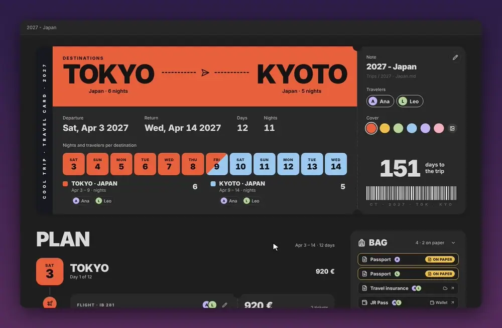
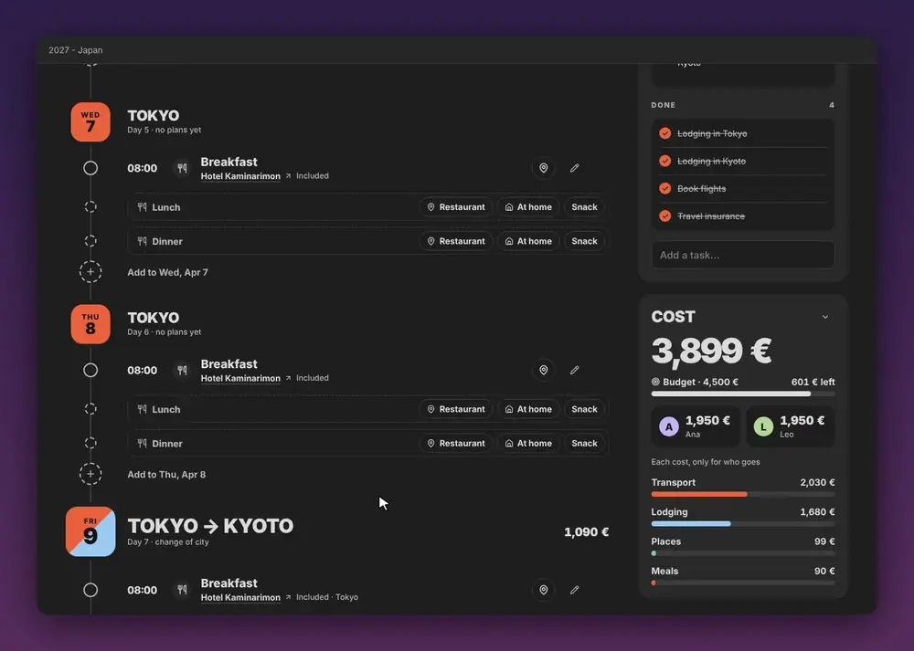
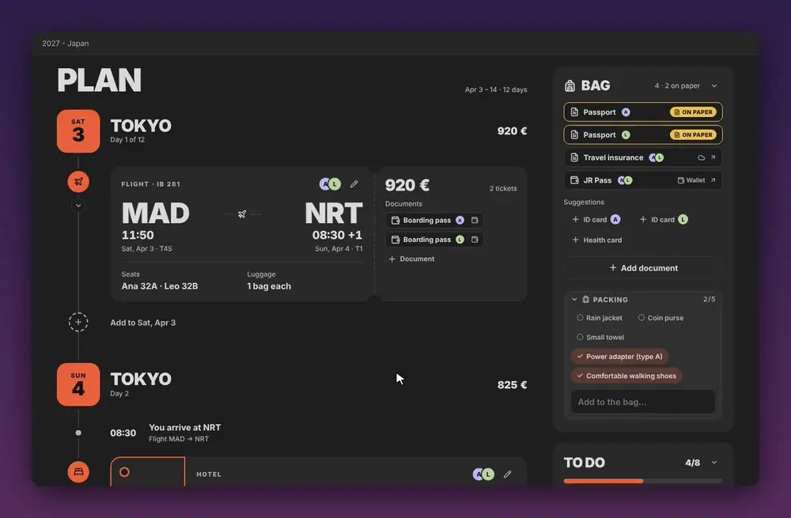
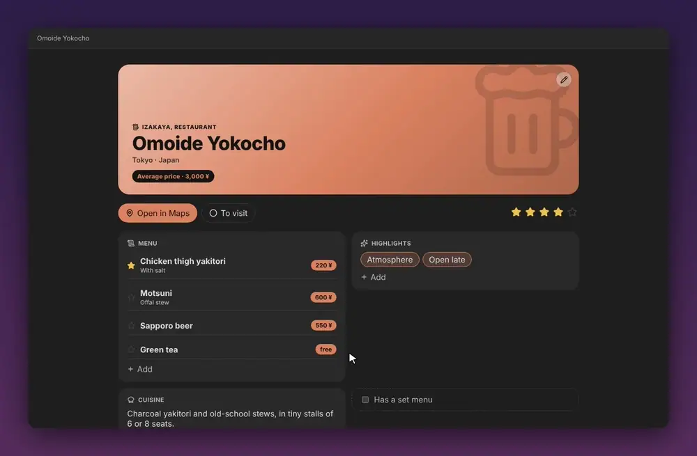
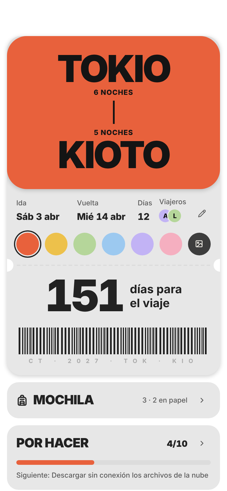
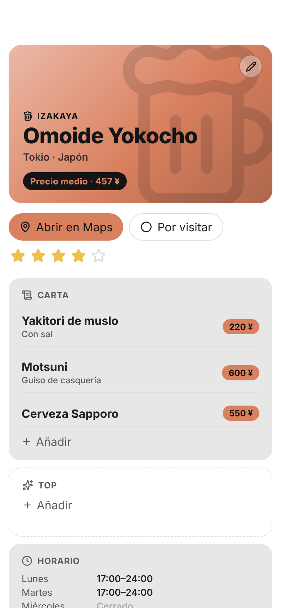
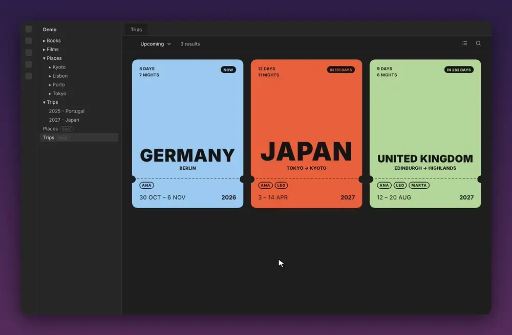
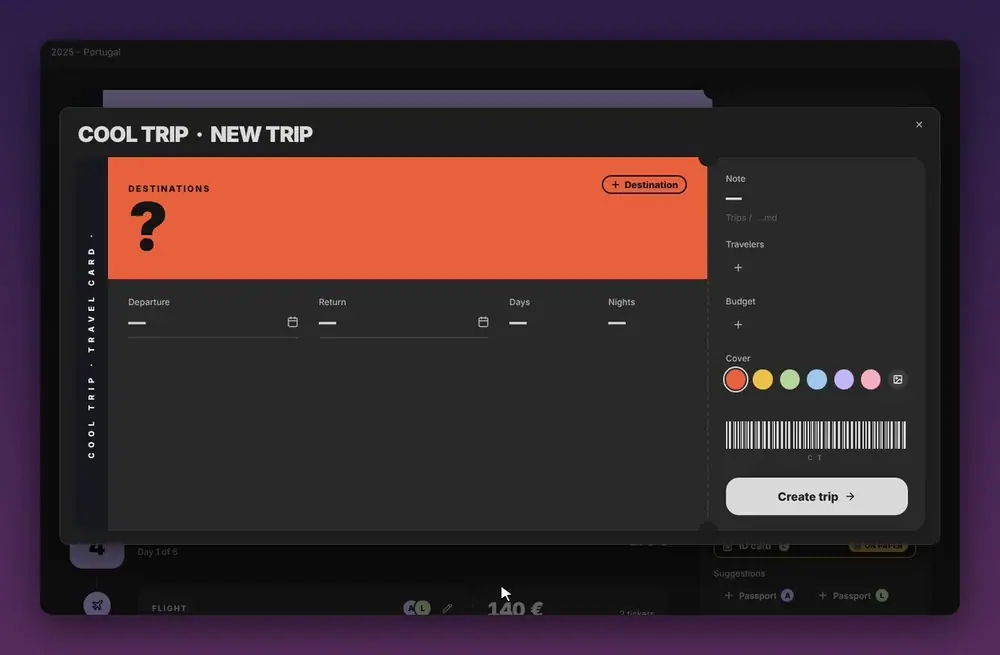

# Cool Trip

Cada viaje en una nota de Obsidian: una portada como tarjeta de embarque, el plan día a día con reservas, documentos y coste, y una ficha para cada sitio que quieres ver.

🇬🇧 [Read in English](README.md)



## Qué hace

- **Una nota por viaje.** La portada es una tarjeta de embarque con los destinos, las fechas, las noches, los viajeros y la cuenta atrás. Debajo, el plan día a día y, al lado, la mochila, la maleta, lo que tienes por hacer y el coste. Todo es Markdown normal que Cool Trip escribe y pinta encima: si desactivas el plugin, la nota sigue completa.

- **El plan, día a día.** Añade a cada día lugares, comidas, transporte, alojamiento y notas, con hora, precio, para quién y sus documentos. Arrastra los pasos para ordenarlos o moverlos de día. Cada día te sugiere los lugares que tienes guardados en esa ciudad.

  

- **Reservas y documentos en un sitio.** Tarjetas de embarque, entradas y pasaportes: dónde está cada uno (tu nube, la cartera del móvil, una carpeta de tu dispositivo, el vault o en papel) y para quién. El localizador, la hora y el asiento se ven siempre en la nota.

- **Mochila, maleta y por hacer.** La maleta con casillas, tus tareas con fecha límite y los recordatorios que añade Cool Trip: descargar los mapas sin conexión, descargar los archivos de la nube, hacer el check-in.

- **Lo que cuesta.** Los precios se suman contra el presupuesto, con lo que falta por pagar, en la moneda del viaje.

  

- **Una ficha para cada lugar.** Las notas de lugar se abren como una página hecha para su tipo: un restaurante tiene carta y horario; un museo, sus entradas y lo imprescindible; una sala, su programación y su aforo. Cada tipo tiene su icono y su color.

  

- **Pensado para el móvil.** Cada pantalla tiene su versión móvil, y los lugares y los días se abren en tu app de mapas (Google Maps, Apple Maps u Organic Maps).

  <p> </p>

- **Tus viajes y lugares en Bases.** Cool Trip crea una base de viajes y otra de lugares y las mantiene al día. Con [Cool Bases](https://github.com/pattgue/cool-bases) se ven como tarjetas de embarque y como una guía por ciudad.

  

## Instalarlo

**Desde Complementos de la comunidad** (cuando esté en la lista): Ajustes → Complementos de la comunidad → Explorar → busca **Cool Trip** → Instalar → Activar.

**Con BRAT:** instala el plugin [BRAT](https://github.com/TfTHacker/obsidian42-brat), elige **Add beta plugin** y pega `pattgue/cool-trip`.

**A mano:** descarga `main.js`, `manifest.json` y `styles.css` de la [última versión](https://github.com/pattgue/cool-trip/releases/latest) y ponlos en `.obsidian/plugins/cool-trip/` dentro de tu vault. Reinicia Obsidian y activa **Cool Trip** en Ajustes → Complementos de la comunidad.

## Para empezar

1. Abre Ajustes → **Cool Trip** y sigue los pasos. Cada uno adapta Cool Trip a las notas y propiedades que ya tienes.
2. Crea un viaje: el comando **Nuevo viaje** o la **Cool Bar**. Elige los destinos, las fechas y un color o una foto; la tarjeta de embarque se dibuja mientras escribes.

   
3. Rellena el plan desde la nota del viaje. Toca el lápiz de la tarjeta para cambiar el viaje.

## Ajustes

| Paso | Qué eliges |
|---|---|
| 1 · Tus notas | Cómo los reconoce: por carpeta (lo normal), por propiedad o por etiqueta. Si las notas de lugar se abren como ficha. |
| 2 · Propiedades | Qué propiedad tuya guarda cada dato. Te propone las que ya tienes, si son del tipo adecuado. |
| 3 · Archivos | Dónde guardas tus archivos: tu nube, la cartera del móvil, tu dispositivo o el vault. |
| 4 · Mapas | Tu app de mapas, cómo te mueves y si busca las coordenadas sola. |
| 5 · Bases | Crear las bases de viajes y lugares. |
| 6 · Cool Bar | La barra común de todos los plugins Cool. |
| 7 · Listo | Un resumen de lo que Cool Trip escribe en tu vault. |

## Tus notas siguen siendo tuyas

- **Solo escribe lo que rellenas.** Una propiedad solo se crea cuando rellenas su campo en Cool Trip. Nada de propiedades vacías ni añadidas por su cuenta.
- **Usa tus propiedades.** Elige qué propiedad tuya usar para cada dato, o deja las sugeridas. Nunca cambia su tipo, y las que no cambia las deja exactamente como estaban.
- **Lo que no hace falta para buscar ni filtrar va dentro de la nota:** el color del viaje, el presupuesto, las reservas, los documentos, la maleta, las tareas y el plan.
- **Los colores y los iconos son del plugin.** La nota de un lugar solo dice qué tipo de lugar es, con su `categoría`.

La lista completa de propiedades está en [docs/propiedades.md](docs/propiedades.md).

## Preguntas frecuentes

**¿Cómo queda una nota de viaje sin el plugin?**
Como una nota normal: un callout con el nombre y los destinos, y secciones para la mochila, la maleta, lo que hay por hacer y el plan, con un título por día. Cool Trip lee y escribe ese mismo Markdown.

**¿Se conecta a internet?**
Solo para buscar las coordenadas de un lugar, si activas **Buscar las coordenadas solas** (Ajustes → 4, activado por defecto). Manda a OpenStreetMap (Nominatim) el nombre y la ciudad del lugar, y nada más. Los mapas se abren en tu app de mapas.

**¿Necesito Cool Bases?**
No. Cool Trip funciona solo. Cool Bases solo les da a las bases el aspecto de tarjeta de embarque y de guía por ciudad.

**¿Dónde se guardan mis documentos?**
Donde elijas en Ajustes → 3. Cool Trip solo guarda un enlace a cada archivo. Si sincronizas el vault con Obsidian Sync, deja fuera del vault los archivos grandes: Sync tiene un límite de tamaño por archivo.

## Compatibilidad

- Obsidian **1.10** o posterior.
- Ordenador y móvil.
- Español e inglés, según el idioma de Obsidian.

## Ayuda y sugerencias

¿Algo no funciona o tienes una idea? Abre un [issue en GitHub](https://github.com/pattgue/cool-trip/issues). Las capturas ayudan mucho.

## Desarrollo

```bash
npm install
npm run dev      # vigila src/ y css/ y compila main.js y styles.css
npm run check    # tipos
npm run lint     # las reglas de eslint-plugin-obsidianmd
npm test         # el Markdown de viajes y lugares, los ajustes y las bases, sin Obsidian
node test/harness.mjs        # pinta todas las pantallas en Chromium con un Obsidian falso (test/out/)
node test/readme-shots.mjs   # las capturas del README (antes: node test/harness.mjs light)
```

Cómo está hecho: [docs/arquitectura.md](docs/arquitectura.md).

## Licencia

[MIT](LICENSE) © 2026 Patt

La interfaz usa [Inter](https://rsms.me/inter/), incluida con la [SIL Open Font License 1.1](fonts/OFL.txt).
