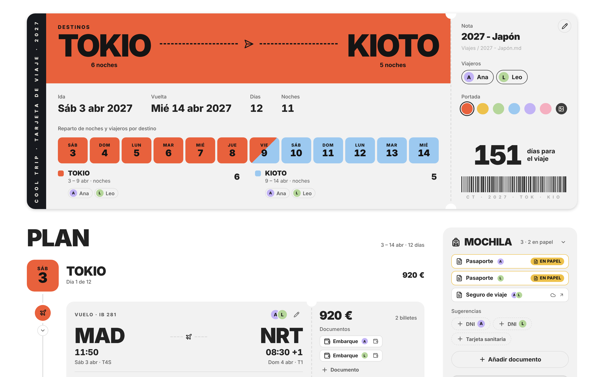
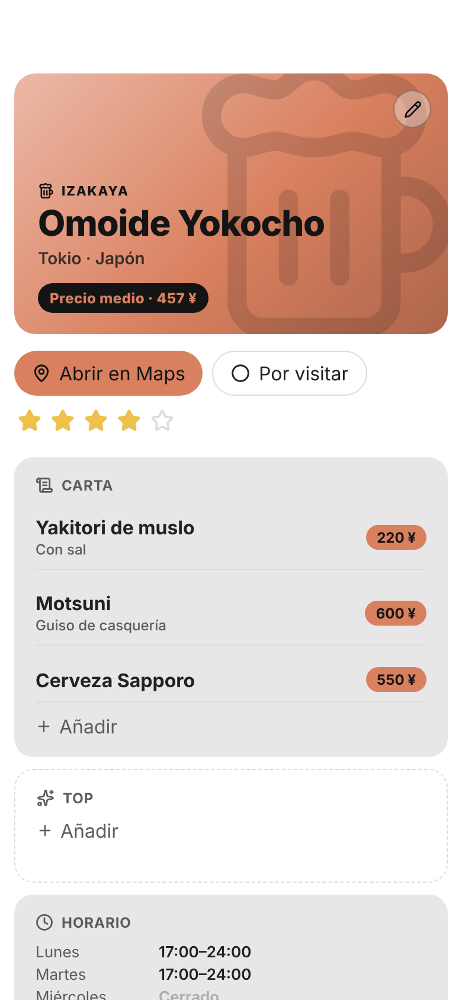
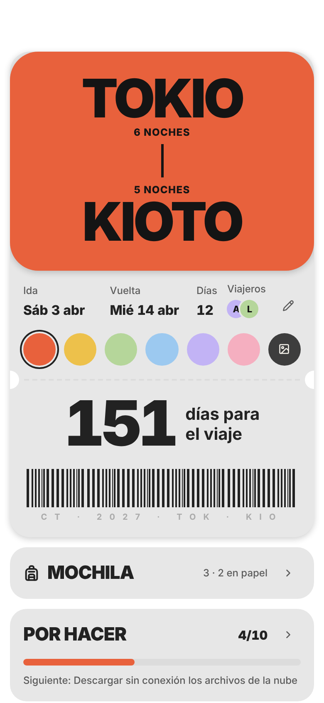
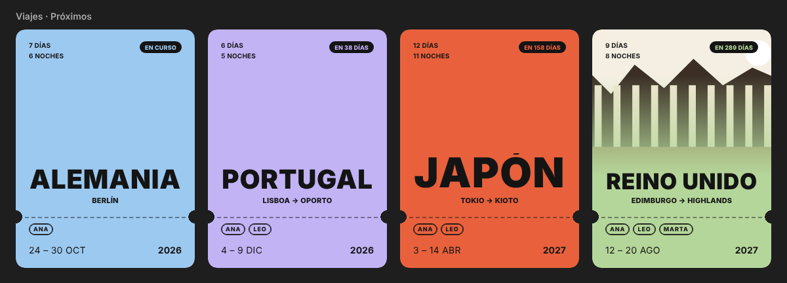
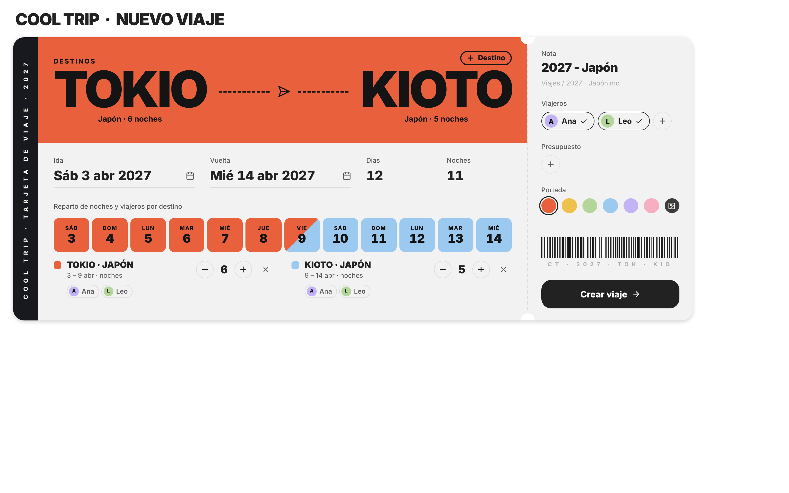

# Cool Trip

Plan each trip in one Obsidian note: a boarding-pass cover, a day-by-day plan with bookings, documents and costs, and a page for every place you want to see.

🇪🇸 [Leer en español](README.es.md)



## What it does

- **One note per trip.** The cover is a boarding pass with the destinations, dates, nights, travelers and a countdown. Below it, the plan day by day, and on the side your bag, packing list, to-dos and costs. Everything is plain Markdown that Cool Trip writes and draws on top: switch the plugin off and the note is still complete.

- **The plan, day by day.** Add places, meals, transport, lodging and notes to each day, with time, price, who it's for and its documents. Drag steps to reorder them or move them to another day. Each day suggests the places you saved in that city.

- **Bookings and documents in one place.** Boarding passes, tickets and passports: where each one is (your cloud, your phone's wallet, a folder on your device, the vault or paper) and who it's for. The booking code, time and seat stay visible in the note.

- **Bag, packing and to-dos.** A packing list with checkboxes, your to-dos with due dates, and reminders Cool Trip adds for you: download offline maps, download your cloud files, check in online.

- **What it costs.** Prices add up against your budget, with what is still unpaid, in the trip's currency.

- **A page for every place.** Place notes open as a page made for their kind: a restaurant has a menu and opening hours, a museum its tickets and highlights, a venue its programme and capacity. Each kind has its own icon and color.

  

- **Made for the phone.** Every screen has its mobile version, and places and days open in your maps app (Google Maps, Apple Maps or Organic Maps).

  

- **Your trips and places in Bases.** Cool Trip creates a trips base and a places base and keeps them up to date. With [Cool Bases](https://github.com/pattgue/cool-bases) they show up as boarding passes and a city guide.

  

## Install

**From Community plugins** (once it's listed): Settings → Community plugins → Browse → search for **Cool Trip** → Install → Enable.

**With BRAT:** install the [BRAT](https://github.com/TfTHacker/obsidian42-brat) plugin, choose **Add beta plugin** and paste `pattgue/cool-trip`.

**By hand:** download `main.js`, `manifest.json` and `styles.css` from the [latest release](https://github.com/pattgue/cool-trip/releases/latest) and put them in `.obsidian/plugins/cool-trip/` inside your vault. Restart Obsidian and enable **Cool Trip** in Settings → Community plugins.

## Quick start

1. Open Settings → **Cool Trip** and go through the steps. Each one adapts Cool Trip to the notes and properties you already have.
2. Create a trip: the **New trip** command, or the **Cool Bar**. Pick the destinations, the dates and a color or a photo; the boarding pass draws itself as you type.

   
3. Fill the plan from the trip note. Tap the pencil on the boarding pass to change the trip.

## Settings

| Step | What you choose |
|---|---|
| 1 · Your notes | How Cool Trip recognizes them: by folder (the default), by property or by tag. Whether place notes open as a page. |
| 2 · Properties | Which of your properties holds each piece of data. It suggests the ones you already have, of the right type. |
| 3 · Files | Where you keep your files: your cloud, your phone's wallet, your device or the vault. |
| 4 · Maps | Your maps app, how you get around, and whether to look up coordinates automatically. |
| 5 · Bases | Create the trips and places bases. |
| 6 · Cool Bar | The bar shared by all the Cool plugins. |
| 7 · Done | A summary of what Cool Trip writes in your vault. |

## Your notes stay yours

- **It only writes what you fill in.** A property is created only when you fill its field in Cool Trip. No empty properties, nothing added on its own.
- **It uses your properties.** Choose which of your properties to use for each piece of data, or leave the suggested ones. It never changes their type, and it keeps the properties it doesn't change exactly as they were.
- **What isn't needed for searching or filtering goes inside the note:** the trip's color, the budget, bookings, documents, packing list, to-dos and the plan.
- **Colors and icons belong to the plugin.** A place note only says what kind of place it is, with its `category`.

The full list of properties is in [docs/propiedades.md](docs/propiedades.md) (in Spanish).

## FAQ

**What does a trip note look like without the plugin?**
A normal note: a callout with the name and destinations, and sections for the bag, packing list, to-dos and plan, one heading per day. Cool Trip reads and writes that same Markdown.

**Does it connect to the internet?**
Only to look up the coordinates of a place, if you turn on **Find coordinates automatically** (Settings → 4, on by default). It sends the place's name and city to OpenStreetMap (Nominatim) and nothing else. Maps open in your maps app.

**Do I need Cool Bases?**
No. Cool Trip works on its own. Cool Bases only gives the bases their boarding-pass and city-guide look.

**Where are my documents stored?**
Wherever you choose in Settings → 3. Cool Trip only keeps a link to each file. If your vault syncs with Obsidian Sync, keep large files out of the vault: Sync has a size limit per file.

## Compatibility

- Obsidian **1.10** or later.
- Desktop and mobile.
- English and Spanish, following Obsidian's language.

## Support and feedback

Found a bug or have an idea? Open an [issue on GitHub](https://github.com/pattgue/cool-trip/issues). Screenshots help a lot.

## Development

```bash
npm install
npm run dev      # watches src/ and css/ and builds main.js and styles.css
npm run check    # types
npm run lint     # eslint-plugin-obsidianmd rules
npm test         # the Markdown of trips and places, settings and bases, without Obsidian
node test/harness.mjs        # renders every screen in Chromium with a fake Obsidian (test/out/)
node test/readme-shots.mjs   # the README screenshots (after: node test/harness.mjs light)
```

How it's built: [docs/arquitectura.md](docs/arquitectura.md) (in Spanish).

## License

[MIT](LICENSE) © 2026 Patt
